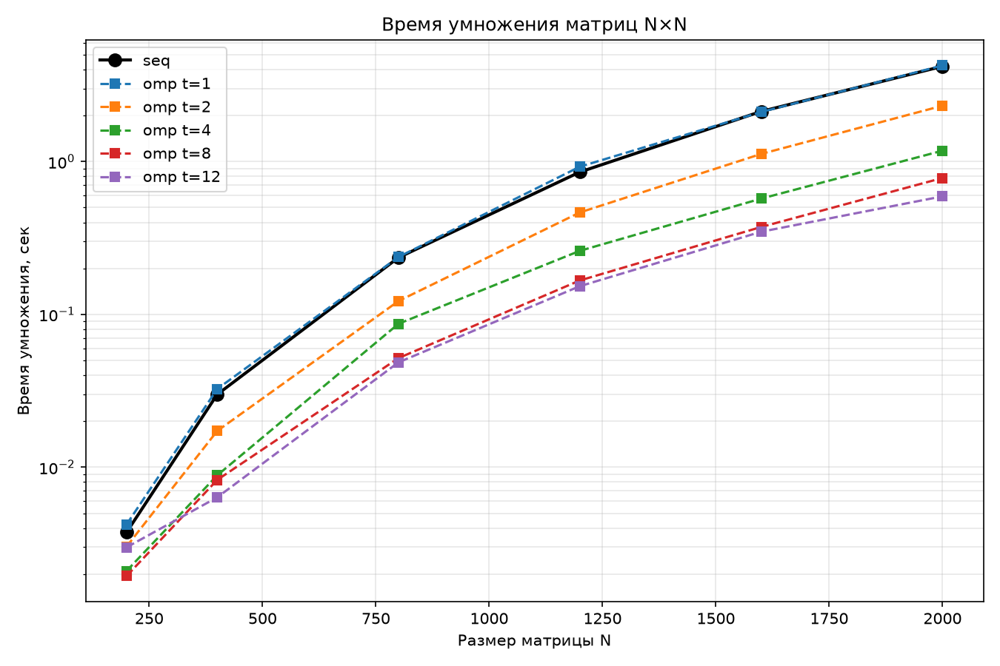
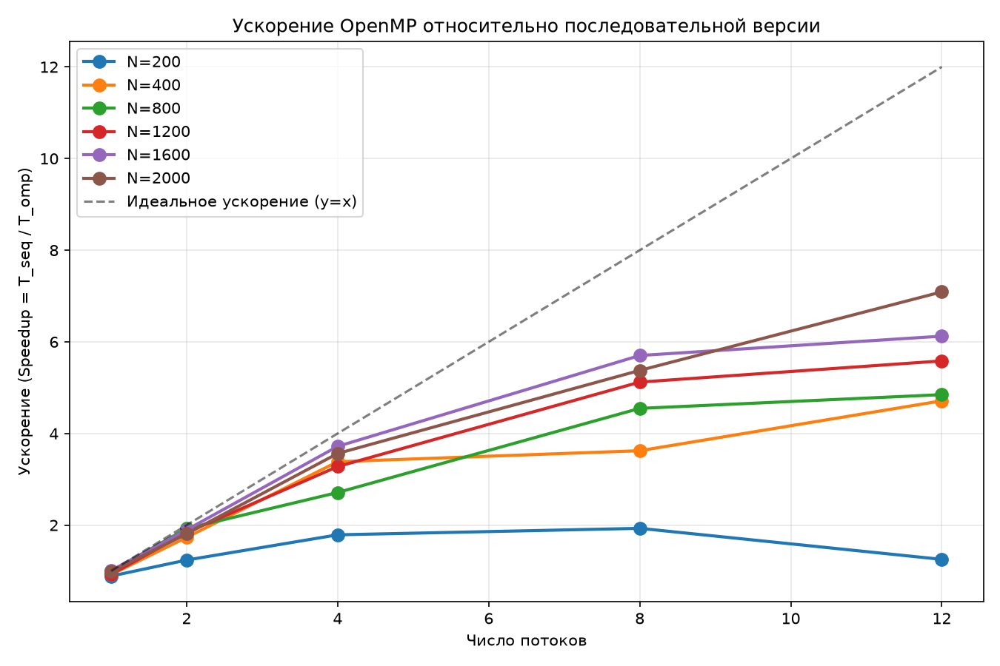
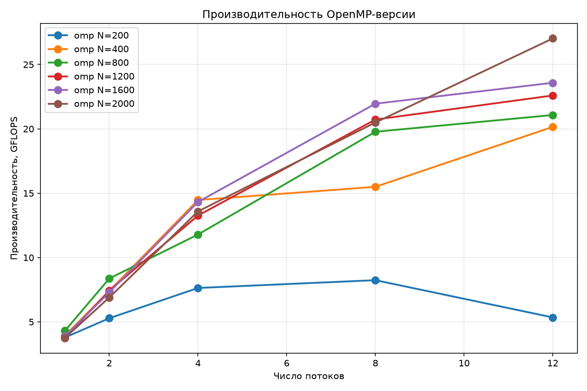
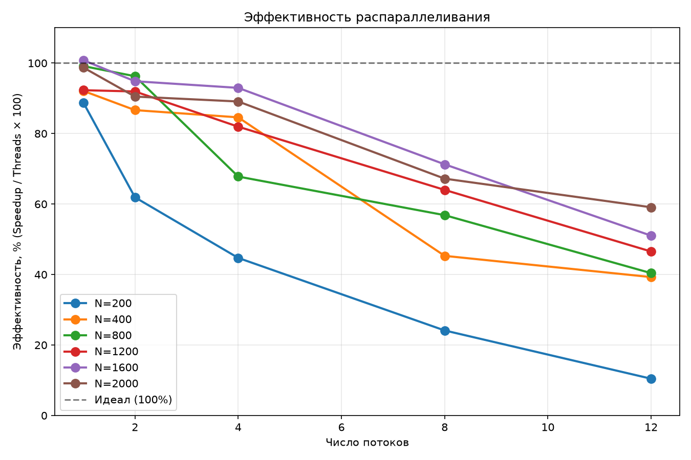

# Отчёт по лабораторной работе №2

**Дисциплина:** Параллельное программирование  
**Тема:** Исследование масштабируемости параллельного умножения матриц с использованием OpenMP  
**Студент:** Янкин Влас Александрович
**Группа:** 6211-100503D
**Преподаватель:** Минаев Евгений Юрьевич 
**Год:** 2026

---

## 1. Цель работы

Исследовать масштабируемость параллельной программы (на примере умножения квадратных матриц) при увеличении размеров задачи и изменении количества вычислительных потоков с использованием технологии OpenMP. Провести серию экспериментов и проанализировать эффективность распараллеливания.

## 2. Постановка задачи

1. Модифицировать программу из лабораторной работы №1 (умножение квадратных матриц с помощью OpenMP).
2. Провести серию экспериментов:
   - Размеры матриц: **N = 200, 400, 800, 1200, 1600, 2000**.
   - Количество потоков: **1, 2, 4, 8, 12**.
   - Аппаратное обеспечение: 12 логических ядер.
3. Оценить время выполнения, ускорение, эффективность и производительность (GFLOPS).
4. Верифицировать результаты с помощью NumPy.

## 3. Краткая теория

### 3.1. Масштабируемость и накладные расходы

Распараллеливание программы всегда связано с накладными расходами (overhead):
- Создание и синхронизация потоков.
- Барьеры (barriers) в конце параллельных циклов.
- Конкуренция за разделяемую память (кэш и оперативная память).

Для маленьких задач эти накладные расходы могут превышать полезную работу, из-за чего параллельная версия оказывается медленнее последовательной. По мере роста размера задачи доля накладных расходов уменьшается, и параллельная программа начинает показывать значительное ускорение. Это называется **масштабируемостью**.

### 3.2. Закон Амдала

Закон Амдала гласит, что ускорение ограничено долей последовательного кода *f*:
**S(p) = 1 / (f + (1 - f) / p)**

Однако на практике для задач, работающих с памятью (как умножение матриц), главным ограничением становится не последовательный код, а **пропускная способность шины памяти (Memory Bandwidth)**. Когда все 12 потоков одновременно обращаются к оперативной памяти за данными (матрица 2000×2000 занимает 16 МБ, что не помещается в кэш процессора), они начинают ждать память. Это приводит к отклонению эффективности от идеальных 100%.

## 4. Реализация

Код программы остался без изменений с лабораторной работы №1:
- **`cpp/matrix_seq.cpp`** — последовательное умножение (три вложенных цикла).
- **`cpp/matrix_omp.cpp`** — параллельное умножение с директивой `#pragma omp parallel for schedule(static)` по внешнему циклу.

Входные данные генерируются скриптом `python/gen_matrices.py`. Замеры проводятся скриптом `python/run_benchmarks.py` (36 запусков), графики строятся скриптом `plot.py`. Корректность проверяется через NumPy (`python/verify.py`).

## 5. Экспериментальные результаты

### 5.1. Сводная таблица

*Замеряется только время умножения (без ввода-вывода).*

| N | threads | time, s | speedup | efficiency | GFLOPS |
|:---:|:---:|:---:|:---:|:---:|:---:|
| 200 | seq | 0.00375 | 1.00 | 100.0 % | 4.27 |
| 200 | 12 | 0.00299 | 1.25 | 10.4 % | 5.35 |
| 400 | seq | 0.02993 | 1.00 | 100.0 % | 4.28 |
| 400 | 12 | 0.00635 | 4.71 | 39.3 % | 20.16 |
| 800 | seq | 0.23553 | 1.00 | 100.0 % | 4.35 |
| 800 | 12 | 0.04859 | 4.85 | 40.4 % | 21.08 |
| 1200 | seq | 0.85416 | 1.00 | 100.0 % | 4.05 |
| 1200 | 12 | 0.15297 | 5.58 | 46.5 % | 22.59 |
| 1600 | seq | 2.12756 | 1.00 | 100.0 % | 3.85 |
| 1600 | 12 | 0.34741 | 6.12 | 51.0 % | 23.58 |
| 2000 | seq | 4.19790 | 1.00 | 100.0 % | 3.81 |
| **2000** | **12** | **0.59206** | **7.09** | **59.1 %** | **27.02** |

### 5.2. Графики

**Время умножения в зависимости от размера матрицы (логарифмический масштаб):**

**Ускорение относительно последовательной версии:**

**Производительность (GFLOPS):**

**Эффективность распараллеливания (КПД):**

### 5.3. Анализ результатов

1. **N = 200 (Малая задача).** Ускорение практически отсутствует (1.25× на 12 потоках). Размер матрицы слишком мал: накладные расходы OpenMP на синхронизацию 12 потоков превышают время полезных вычислений.
2. **N = 400 и 800 (Средние задачи).** Появляется стабильное ускорение (4.7–4.8×). Однако при переходе с 4 на 8 и 12 потоков время почти не падает (эффективность падает до 40%). Это связано с тем, что матрицы размером 800×800 начинают вытеснять данные из кэша L2/L3 процессора.
3. **N = 1600 и 2000 (Крупные задачи).** Ускорение достигает **6.12× и 7.09×** соответственно. Эффективность (КПД) растёт до **59%**. Это наилучший результат: объём вычислений (O(N³)) растёт быстрее, чем объём данных (O(N²)), поэтому накладные расходы становятся незначительными.
4. **Производительность (GFLOPS).** На последовательной версии GFLOPS держится на уровне ~4.2. На параллельной (12 потоков) для N=2000 достигает **27.02 GFLOPS**, то есть рост в **6.3 раза**.
5. **Закон Амдала и память.** На 12 потоках эффективность не достигает 100% даже на больших задачах. Причина — ограничение пропускной способности памяти: 12 потоков одновременно читают разные строки, и кэш-промахи заставляют их ждать оперативную память.

## 6. Выводы

В ходе работы была исследована масштабируемость OpenMP-программы для умножения матриц:
1. **Размер задачи критичен:** на малых матрицах (N=200) параллелизм неэффективен из-за накладных расходов. Значимое ускорение появляется начиная с N=400.
2. **Ускорение растёт с размером:** при увеличении N от 400 до 2000 ускорение на 12 потоках выросло с 4.71× до **7.09×**, а производительность достигла **27 GFLOPS**.
3. **Предел масштабирования:** даже на больших задачах КПД не превышает ~60%. Это объясняется законом Амдала и ограничениями подсистемы памяти (Memory Bandwidth), а не только последовательным кодом.
4. **Корректность:** все результаты подтверждены верификацией через NumPy (полное поэлементное совпадение, включая матрицы 2000×2000).

**Практический вывод:** технология OpenMP показывает максимальную эффективность при больших объёмах вычислений и хорошей локальности данных. Для задач, ограниченных памятью, дальнейшее увеличение потоков свыше количества физических ядер не даёт прироста производительности.